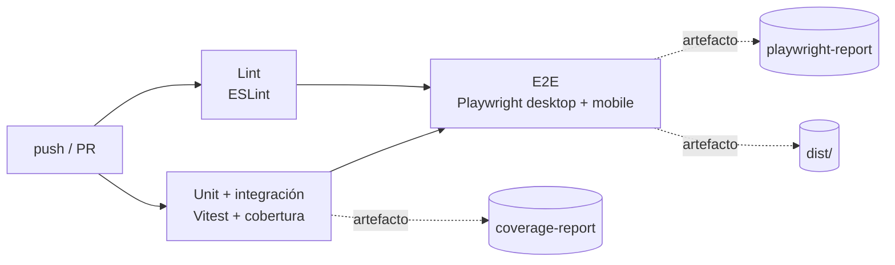

# Lavaditos · Tienda online de mates y termos

[](https://github.com/JoaquinYap/LandingMate/actions/workflows/ci.yml)


-6f42c1)

Lavaditos empezó como una landing page y hoy es una **tienda completa en JavaScript puro (sin frameworks)**:
catálogo con búsqueda y filtros, carrito persistente con control de stock y un **checkout de 4 pasos con pago simulado**.
Todo está cubierto por un **pipeline de tests automatizados** (unitarios, de integración y end-to-end) que corre en GitHub Actions en cada push.

> 💳 **Modo demo:** no se procesan pagos reales. Tarjeta aprobada `4242 4242 4242 4242`, rechazada `4000 0000 0000 0002`, cualquier vencimiento futuro y CVV. Cupones: `MATERO10` (10% OFF) y `BIENVENIDA` ($5.000 OFF desde $40.000).

---

## ✨ Funcionalidades

| Área | Qué incluye |
|---|---|
| **Catálogo** | Búsqueda tolerante a tildes, 6 categorías con contadores, rango de precio, "solo con stock", "en oferta", 6 órdenes. Los filtros se guardan en la URL (`?cat=termos&orden=precio-asc`), así que cada búsqueda se puede compartir. |
| **Carrito** | Persistente (`localStorage`), sincronizado entre pestañas, límite por stock y por línea, grabado láser por unidad, barra de progreso al envío gratis, pedido alternativo por WhatsApp. |
| **Armá tu set** | Personalizador mate + termo + bombilla con 15% OFF; el mismo set agregado dos veces suma cantidad en lugar de duplicar la línea. |
| **Checkout** | 4 pasos (contacto → envío → pago → confirmación) con validación por paso, stepper navegable, cupones, 3 métodos de envío, tarjeta en 1/3/6 cuotas, transferencia con 10% OFF acumulable, Mercado Pago (simulado), tarjeta rechazada con reintento, confirmación con número de pedido que sobrevive a una recarga. |
| **Seguridad** | Todo contenido dinámico se escapa (sin inyección de HTML); los precios se vuelven a tomar del catálogo (un `localStorage` manipulado no abarata nada); el pedido guardado **nunca** contiene el número completo de tarjeta ni el CVV. |
| **Accesibilidad** | Diálogos modales con foco atrapado y retorno de foco, `inert` en overlays cerrados, tabs ARIA con flechas, errores de formulario asociados con `aria-describedby`/`aria-invalid`, regiones `aria-live`, skip-link, contraste AA. |
| **Responsive** | Desktop, tablet y mobile; en mobile el resumen del checkout arranca colapsado mostrando el total. |

## 🧪 Pipeline de tests

```
            ▲   E2E · Playwright          26 escenarios × 2 dispositivos (Desktop Chrome + Pixel 7)
           ▲▲▲  Integración · Vitest+jsdom  73 tests: vistas montadas sobre el HTML real + Testing Library
         ▲▲▲▲▲▲ Unitarios · Vitest         205 tests: carrito, filtros, precios, validaciones, pago, flujo
```

| Capa | Herramientas | Qué verifica |
|---|---|---|
| **Unitarios** (`tests/unit`) | Vitest | Lógica pura sin DOM: reglas de precio y descuentos, algoritmo de Luhn, CP argentino/CPA, stock del carrito, saneamiento del storage, máquina de estados del checkout, serialización de filtros en la URL. |
| **Integración** (`tests/integration`) | Vitest · jsdom · Testing Library · user-event | Cada vista montada sobre el `index.html`/`checkout.html` reales. Se consulta **por rol y nombre accesible** (como lo haría un lector de pantalla), así que los tests también validan la semántica. |
| **End-to-end** (`e2e/`) | Playwright · axe-core | Recorridos completos contra el **build de producción**: compra con tarjeta en cuotas, transferencia + cupón, tarjeta rechazada y reintento, persistencia al recargar, navegación por teclado y auditoría **WCAG 2.2 AA** con axe en cada paso del checkout. |
| **Estático** | ESLint | Reglas recomendadas + `eqeqeq`, `prefer-const`, `no-console`, etc. |

**Cobertura** medida con V8 y **umbrales que hacen fallar el CI**: 95% de líneas y sentencias, 90% de funciones, 85% de ramas (hoy: ~99% líneas · ~97% sentencias · ~94% funciones · ~88% ramas).
`src/ui/effects.js` (parallax, contadores, marquee: puramente decorativo) se excluye del umbral y se valida en los E2E.

### Bugs reales que encontraron los tests

- **El foco no entraba al carrito con "reducir movimiento" activado.** El CSS original fuerza transiciones de 0.01 ms en *todos* los elementos; como `transition-property` es `all` por defecto, la `visibility` heredada también "transicionaba" y en el instante del `focus()` el botón seguía oculto. Lo detectó un test E2E de teclado; afectaba justamente a quienes más dependen del teclado.
- **El navbar original medía 466 px**: en teléfonos de 412 px Chrome agrandaba el layout viewport y la página se podía desplazar de costado (con el carrito abierto, los clics caían en el lugar equivocado). Lo destapó un E2E mobile que falló solo en el runner de CI; además, el test de "sin scroll horizontal" pasaba en falso porque comparaba contra `innerWidth`, que crece junto con el contenido. Ahora compara contra el ancho real del dispositivo y también se prueba a 360 px.
- **El header sticky del checkout tapaba el campo enfocado** en mobile al mostrar errores (WCAG 2.4.11). Se resolvió con `scroll-padding-top` y quedó cubierto por un test E2E.
- **Contraste insuficiente** en el footer, categorías y precios tachados, y un `aria-label` del logo que no coincidía con su texto visible: los marcó axe-core.
- **Un set personalizado agregado dos veces generaba dos líneas** (el id usaba `Date.now()`); ahora el id es determinístico.

### CI en GitHub Actions

`.github/workflows/ci.yml` corre en cada push y pull request:



- Si la cobertura baja del umbral, el job falla.
- El resumen de cobertura se publica en la página de la corrida (*job summary*).
- Los reportes HTML de cobertura y de Playwright (con trazas de los tests fallidos) quedan como artefactos.

## 🏗️ Arquitectura

La clave para poder testear fue **separar la lógica de la UI**. El `app.js` original (1.200 líneas acopladas al DOM) se dividió en módulos ES:

```
landingmate/
├── index.html · checkout.html     Páginas (HTML semántico)
├── styles.css · store.css         Design system original + estilos de tienda/checkout
├── public/assets/images/          Imágenes de producto
├── src/
│   ├── data/products.js           Catálogo (stock, valoraciones, categorías)
│   ├── lib/                       format (ARS, escape HTML, debounce) · storage seguro
│   ├── store/                     ⬅ lógica pura: cart · catalog · customizer · whatsapp
│   ├── checkout/                  ⬅ lógica pura: pricing · validation · payment · flow
│   ├── ui/                        Vistas: catalog · cart · product-modal · customizer · checkout
│   │                              + a11y (diálogos, anuncios) · motion · effects
│   └── pages/                     Entry points: home.js · checkout.js
├── tests/{unit,integration,helpers}
└── e2e/                           Specs de Playwright
```

- **Stores puros con dependencias inyectables** (`createCart({ storage })`, `createCheckoutFlow({ storage, now })`, `processPayment(p, { delay, wait, random })`): los tests usan storage en memoria, fecha fija y aleatoriedad determinística.
- **Vistas como funciones `mountX(deps)`** que se suscriben al store y renderizan; reciben `location`/`history` para probar la sincronización con la URL sin navegar.
- **Sin frameworks a propósito**: el objetivo era aprender los fundamentos (estado, eventos, foco, ARIA) que los frameworks abstraen. Vite se usa solo como servidor de desarrollo y bundler.

## 🚀 Cómo correrlo

Requiere Node 20+.

```bash
cd landingmate
npm install
npm run dev            # http://localhost:5173
```

| Comando | Qué hace |
|---|---|
| `npm run dev` | Servidor de desarrollo |
| `npm run build` / `npm run preview` | Build de producción (multipágina, rutas relativas) y preview en :4173 |
| `npm test` | Unitarios + integración |
| `npm run test:unit` / `npm run test:integration` | Una sola capa |
| `npm run coverage` | Tests + reporte de cobertura (`coverage/index.html`) |
| `npm run test:e2e` | E2E (la primera vez: `npx playwright install chromium`) |
| `npm run lint` | ESLint |
| `npm run test:all` | Todo lo que corre el CI |

## 📄 Licencia

MIT · © 2026 Joaquin Yapura
